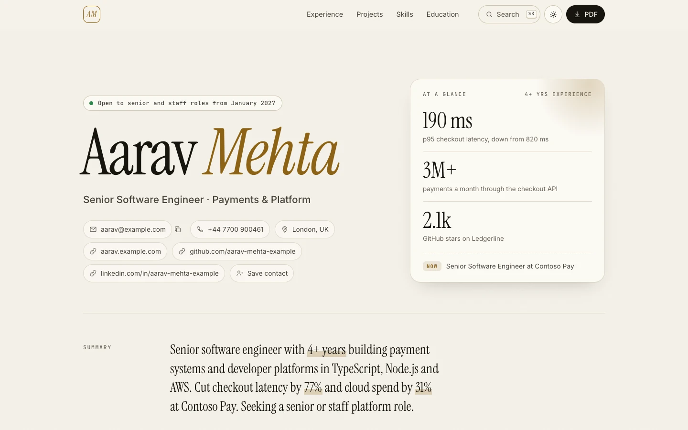
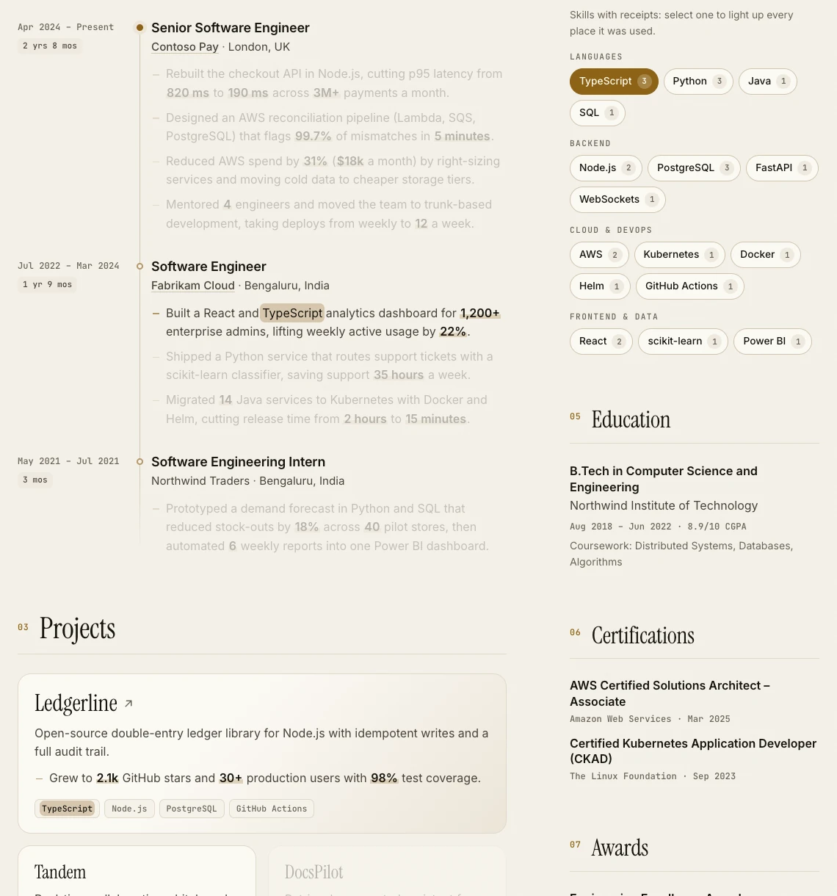
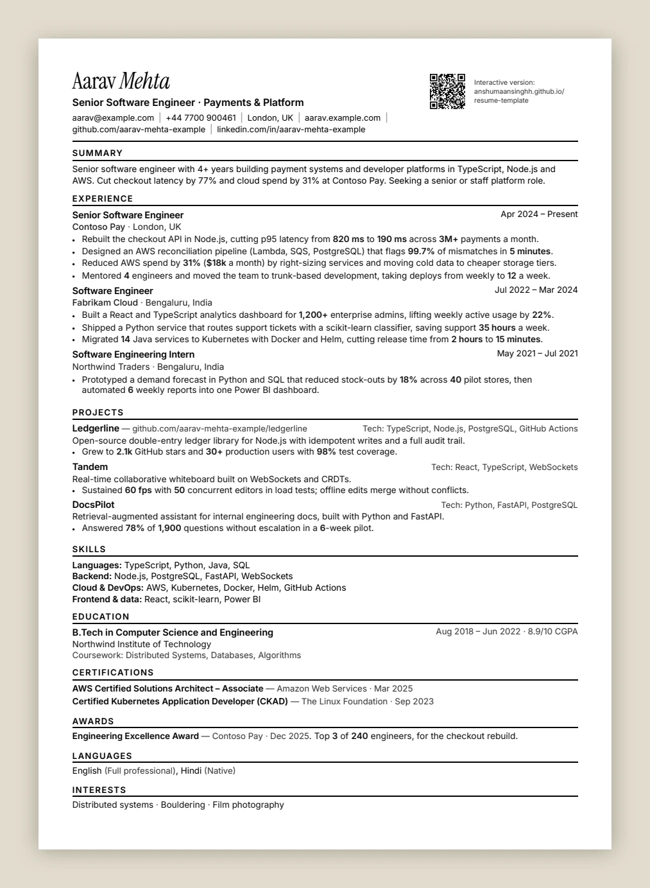
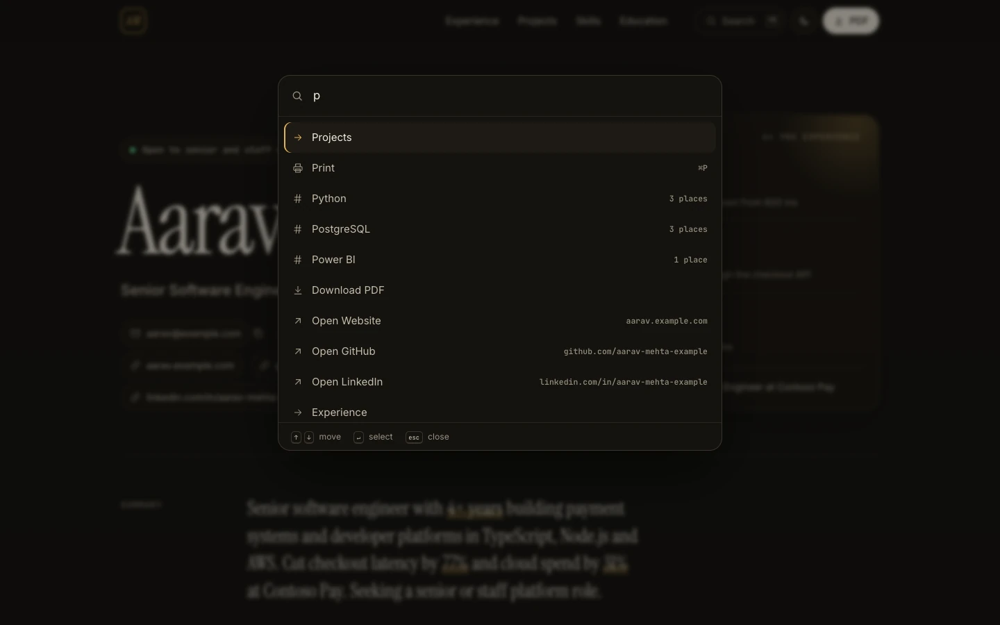
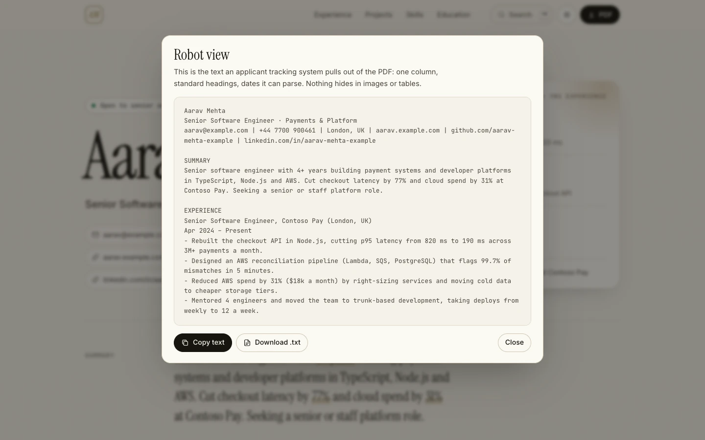
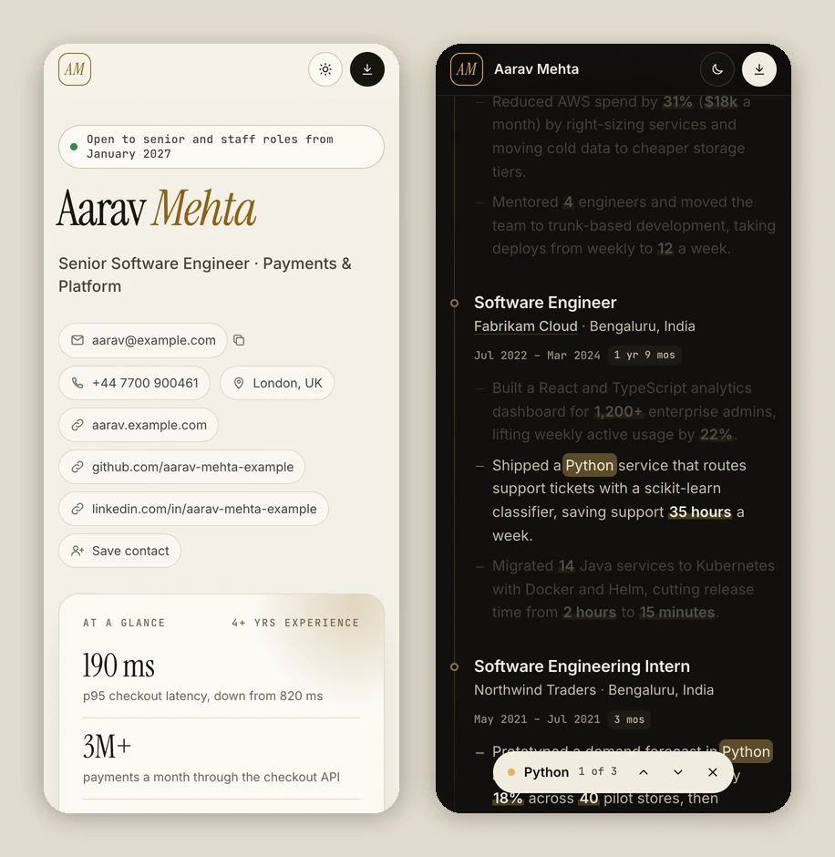

<h1 align="center">Resume Template</h1>

<p align="center">
  <b>Edit one JSON file. Get an editorial resume website, an ATS-safe one-page PDF,<br>a plain-text copy and a resume score that tells you what to fix.</b>
</p>

<p align="center">
  <a href="https://anshumaansinghh.github.io/resume-template/"><b>Live demo</b></a> ·
  <a href="https://anshumaansinghh.github.io/resume-template/resume.pdf">Sample PDF</a> ·
  <a href="https://github.com/AnshumaanSinghh/resume-template/generate">Use this template</a>
</p>

<p align="center">
  
  
  
  
  
</p>

<picture>
  <source media="(prefers-color-scheme: dark)" srcset="docs/hero-dark.webp">
  
</picture>

Most resume templates make you choose: a pretty page that applicant tracking systems (ATS) mangle, or a plain document nobody remembers. This one gives you both from the same file, and checks your writing too.

## What makes it different

| | |
|---|---|
| **Skills with receipts** | Every skill chip shows how many places it is actually used. Click one and the page lights up each bullet and project that proves it, with a navigator to step through them. Recruiters can see the evidence for a skill instead of taking the list on trust. |
| **One file, every format** | `resume.json` (the open [JSON Resume](https://jsonresume.org/schema) standard) builds the website, `resume.pdf`, `resume.txt`, a `contact.vcf` card and the social preview image. |
| **ATS-safe PDF, built automatically** | Single column, standard headings, parseable dates, real embedded fonts and a reading order that is tested, not assumed. [How](#how-the-pdf-stays-ats-safe) |
| **Robot view** | Press <kbd>R</kbd> to see exactly the text an ATS extracts from your PDF. |
| **Resume score** | `npm run check` scores your content out of 100 on 10 checks (action verbs, numbers, clichés, unbacked skills, dates…) and tells you which line to fix. The score also appears on every GitHub Actions run. |
| **Numbers that pop** | Metrics in your bullets (`820 ms`, `31%`, `$18k`, `3M+`) are detected and highlighted automatically, so the impact is visible at a skim. |
| **Command menu** | <kbd>⌘</kbd><kbd>K</kbd> / <kbd>Ctrl</kbd><kbd>K</kbd> jumps to sections and skills, copies your email, downloads the PDF or switches theme. |
| **Paper to web** | The printed PDF carries a QR code back to the live site. The site has a one-tap “Save contact” card for phones. |
| **Fast, private, accessible** | No frameworks, trackers or third-party requests. Self-hosted fonts, a hash-based Content Security Policy, light and dark themes, keyboard support and reduced-motion support. |

<p align="center">
  
</p>

## Quick start (no install needed)

1. Click **[Use this template](https://github.com/AnshumaanSinghh/resume-template/generate)** and create your repository.
2. In your new repo, open **Settings → Pages** and set **Source** to **GitHub Actions**.
3. Edit **`resume.json`** right on GitHub and commit.

The build works out your site address (`https://<you>.github.io/<repo>/`) for the QR code and social card. On a custom domain, set `meta.canonical` in `resume.json` or a `SITE_URL` repository variable.

That's it. Each commit rebuilds and publishes:

| | |
|---|---|
| Website | `https://<you>.github.io/<repo>/` |
| PDF | `https://<you>.github.io/<repo>/resume.pdf` |
| Plain text | `https://<you>.github.io/<repo>/resume.txt` |

The **Actions** tab shows your resume score for every commit.

## Run it locally

Requires [Node.js](https://nodejs.org) 20 or newer, and Chrome, Edge, Chromium or Brave to render the PDF. There is nothing to `npm install`.

```bash
npm run dev     # live preview at http://localhost:4321, rebuilds and reloads as you edit
npm run build   # dist/: index.html, resume.pdf, resume.txt, contact.vcf, og.png
npm run check   # your resume score, with fixes
npm test        # the template's own tests
```

If no Chromium-based browser is found, the build still works: it skips the PDF and the PDF button opens the print dialog instead. Set `CHROME_PATH` to point at a browser in a non-standard location.

## Your resume score

```text
  Resume score  100/100  ██████████████████████████████  Outstanding

  ✓ Contact details             10/10
  ✓ Headline & summary          10/10
  ✓ Starts with action verbs    15/15
  ✓ Quantified impact           15/15
  ✓ Bullet length (8–35 words)  10/10
  ✓ No clichés or filler        10/10
  ✓ Skills backed by evidence   10/10
  ✓ Dates & order               10/10
  ✓ Overall length               5/5
  ✓ Verb variety                 5/5
```

For comparison, the content of this repository's first version scores **41/100** (`npm run check test/fixtures/v1-template.json`). The checker flags its first-person summary, the buzzword “passionate”, bullets with no numbers, skills never mentioned anywhere else, and “20XX” dates.

| Check | What it looks for |
|---|---|
| Contact details | Name, a valid email, phone, city and country, at least one link |
| Headline & summary | A target title; a 25–80 word summary with no “I” or “my” |
| Action verbs | Bullets that open with a strong verb (*Built*, *Cut*, *Led*), not *Responsible for* or *Worked on* |
| Quantified impact | At least 60% of bullets carry a number: time, %, money, users, latency |
| Bullet length | 8–35 words: long enough for a result, short enough to skim |
| Clichés | *passionate*, *team player*, *results-driven*, *synergy* and 25 more |
| Skills backed by evidence | Every listed skill appears in at least one bullet or project |
| Dates & order | Valid `YYYY-MM` dates, end after start, newest role first |
| Overall length | 250–700 words: a strong one-page resume |
| Verb variety | No opening verb used more than twice |

The score is a heuristic based on common recruiter and ATS guidance. A high score means clean, scannable, evidence-backed content; it cannot predict how a particular ATS or recruiter will rank you.

## How the PDF stays ATS-safe



The PDF is the same page printed through a dedicated print stylesheet. Several things that look fine on screen quietly break ATS parsing, and the template handles them:

- **Reading order survives.** Chrome paints positioned and transformed elements out of document order, which scrambles the text an ATS extracts (Experience can end up after Certifications). The print styles flatten everything into normal flow, and the demo PDF's extracted text reads top to bottom exactly like `resume.txt`.
- **Real fonts, not drawings.** Variable fonts are embedded in Chrome PDFs as Type 3 glyph drawings, which some parsers cannot read. This template ships static font files, so every glyph is embedded as TrueType with a Unicode text map.
- **One column, standard headings.** *Summary, Experience, Projects, Skills, Education, Certifications.* No tables, text boxes, icons or text inside images.
- **Parseable dates.** `Apr 2024 – Present`, right-aligned beside each role.
- **No ligatures.** “fi” and “fl” stay as separate letters, so keyword matching works.
- **Fits on one page.** The build reports the page count, and the demo fits on one A4 page. Set `meta.template.paper` to `"Letter"` for US paper.

Press <kbd>R</kbd> on the site (or open `resume.txt`) to see the extracted text.

<br clear="right">

## Customise

Everything lives in `resume.json`, which follows the [JSON Resume schema](https://jsonresume.org/schema) (`basics`, `work`, `projects`, `skills`, `education`, `certificates`, `awards`, `publications`, `volunteer`, `languages`, `interests`). Editors like VS Code autocomplete it through the `$schema` line. Sections you leave out are not rendered.

Template options go in `meta.template`:

| Option | Default | What it does |
|---|---|---|
| `status` | none | The “open to work” pill, e.g. `"Open to senior roles from January 2027"` |
| `stats` | auto | Up to three `{ "value", "label" }` headline numbers for the *At a glance* card. Without them it shows years of experience, projects and skills. |
| `accent` | gold | A hex colour, or `{ "light": "#…", "dark": "#…" }`. The whole palette follows it. |
| `paper` | `"A4"` | `"A4"` or `"Letter"` |
| `qr` | `true` | QR code on the PDF linking to `meta.canonical` |
| `aliases` | `{}` | Extra spellings for receipts, e.g. `{ "PostgreSQL": ["Postgres"], "Kubernetes": ["k8s"] }` |
| `countInternships` | `false` | Include internships in the total-experience figure |
| `photo` / `printPhoto` | `true` / `false` | Show `basics.image` on the site, and on the PDF. Many countries advise against photos on resumes. |
| `noindex` | `false` | Ask search engines not to index the page |
| `credit` | `true` | The small “Template by” line in the footer |
| `lang` | `"en"` | The page language |

Skills are matched to bullets case-sensitively and as whole words, so *Java* never matches *JavaScript* and *C* never matches *C++*. If the score reports a skill with no receipts, mention it where you used it, add an alias, or drop it.

Styling lives in `src/style.css` (screen first, print at the end). Behaviour lives in `src/app.js`. With JavaScript turned off, all content, links and the PDF still work; only the interactive extras (command menu, receipts, theme switch) need it.

## Keyboard shortcuts

| Key | Action |
|---|---|
| <kbd>⌘</kbd><kbd>K</kbd> / <kbd>Ctrl</kbd><kbd>K</kbd> or <kbd>/</kbd> | Command menu |
| <kbd>T</kbd> | Light / dark theme |
| <kbd>R</kbd> | Robot view (what an ATS reads) |
| <kbd>J</kbd> / <kbd>K</kbd> | Next / previous receipt while a skill is selected |
| <kbd>Esc</kbd> | Clear the skill highlight |

Links can open with a skill already selected: `…/resume-template/?skill=kubernetes`.

<p align="center">
  
  
</p>

<p align="center">
  
</p>

## Project layout

```text
resume.json            your content (JSON Resume + meta.template)
src/style.css          screen and print styles
src/app.js             theme, command menu, receipts, robot view
public/fonts/          Inter, Instrument Serif, JetBrains Mono (OFL)
scripts/build.mjs      resume.json → dist/
scripts/dev.mjs        live preview server
scripts/check.mjs      resume score
scripts/lib/           renderer, receipts, dates, scorer, QR encoder, Chrome driver
test/                  node:test suite
.github/workflows/     test, score, build and deploy to GitHub Pages
```

## Credits

Built by **[Anshumaan Singh](https://github.com/AnshumaanSinghh)**. MIT licensed: use it for your own resume, fork it and remix it.

- The demo person and the companies are fictional. Contoso, Fabrikam and Northwind are well-known placeholder company names, and the email and phone use ranges reserved for examples.
- Fonts: [Inter](https://github.com/rsms/inter), [Instrument Serif](https://github.com/Instrument/instrument-serif) and [JetBrains Mono](https://github.com/JetBrains/JetBrainsMono), all under the SIL Open Font License.
- The QR encoder follows the structure of [Project Nayuki’s QR Code generator](https://www.nayuki.io/page/qr-code-generator-library) (MIT).
